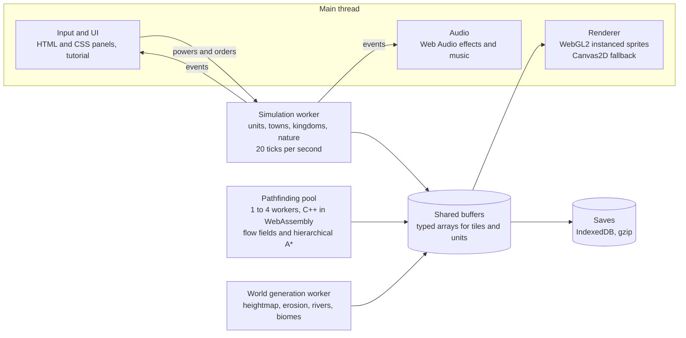

# Pocket Pantheon: Execution Plan

**Owner:** Albeen ([albeen-sknight](https://github.com/albeen-sknight)) · **Repository:** [albeen-sknight/pocket-pantheon](https://github.com/albeen-sknight/pocket-pantheon) · **Live site:** https://albeen-sknight.github.io/pocket-pantheon/ · **Updated:** 13 October 2026 · **Status:** Phase 0 in review, Phase 1 next

Pocket Pantheon is a browser god game. A living pixel world runs itself, and you shape it, command it, bless it or wreck it. This file is the single source of truth for building it. The visual target is the concept preview in [`docs/preview.html`](preview.html).

## How to use this plan

**For Claude Code (the builder):**

1. Read this whole file and open `docs/preview.html` in a browser before writing code.
2. Build one phase at a time, in order (section 21). Never start a phase until the previous gate passes.
3. Every phase ends in a pull request with a playable build. The owner reviews and merges it.
4. Numbers in this plan are design targets. They live in JSON under `data/` so they can be tuned without code changes.
5. All player text lives in `data/text/en.json` and `data/text/es.json`, never in code (sections 20 and 25).
6. When the plan and the code disagree, update the plan in the same pull request and say why.
7. Write all code to the coding standard and add the project signature (section 26).
8. Keep `CLAUDE.md` at the repository root short. It points here and lists the commands (section 27).

**For the owner:** section 27 has the exact prompts to start each phase in Claude Code. Section 26 needs 10 to 30 lines of your own code as a style reference.

## Contents

1. [Vision and pillars](#1-vision-and-pillars)
2. [Concept preview: the visual target](#2-concept-preview-the-visual-target)
3. [Tech stack and languages](#3-tech-stack-and-languages)
4. [Architecture](#4-architecture)
5. [Performance budget](#5-performance-budget-gpu-cpu-ram)
6. [Art direction and visual fidelity](#6-art-direction-and-visual-fidelity)
7. [World generation and biomes](#7-world-generation-and-biomes)
8. [Creatures roster](#8-creatures-roster)
9. [Units: stats, genes, mind](#9-units-stats-genes-mind)
10. [Civilization: towns, economy, tech, equipment](#10-civilization-towns-economy-tech-equipment)
11. [Kingdoms, culture, language, religion, diplomacy](#11-kingdoms-culture-language-religion-diplomacy)
12. [Autonomy: how the world runs itself](#12-autonomy-how-the-world-runs-itself)
13. [War: armies, orders, defense, sieges](#13-war-armies-orders-defense-sieges)
14. [Direct control (Possess) and Clawzilla](#14-direct-control-possess-and-clawzilla)
15. [God powers](#15-god-powers-8-tabs-about-60-powers)
16. [Disasters and chaos](#16-disasters-and-chaos)
17. [Data and statistics](#17-data-and-statistics)
18. [Tutorial and Codex](#18-tutorial-and-codex)
19. [UI, controls, audio, saves](#19-ui-controls-audio-saves)
20. [Languages: English and Spanish](#20-languages-english-and-spanish)
21. [Build phases](#21-build-phases)
22. [Testing](#22-testing)
23. [Deployment to GitHub Pages](#23-deployment-to-github-pages)
24. [Risks and fallbacks](#24-risks-and-fallbacks)
25. [Writing and voice standard](#25-writing-and-voice-standard)
26. [Coding standard and project signature](#26-coding-standard-and-project-signature)
27. [Working with Claude Code](#27-working-with-claude-code)
28. [Appendix: where each request is covered](#28-appendix-where-each-request-is-covered)

## 1. Vision and pillars

Pocket Pantheon is a browser god sim: a living top down pixel world that runs itself, which the player can shape, command, bless or destroy. It is an original game inspired by the god sandbox genre. No assets, names or code are copied from WorldBox or any other game.

The player is the god of a pocket sized world. Four civilized races, 32 creature types and 21 biomes share one map. People are born with genes and a small evolving brain. Then they work, marry, worship, invent, migrate, fight and die. Kingdoms rise, split and fall whether or not the player touches anything.

**Pillars**

- **Alive without you.** Every system runs on its own. Idle play is a valid way to play.
- **Every power is a toy.** Each tool gives instant, visible, satisfying feedback within 100 ms.
- **Stories emerge.** Named people, dynasties, religions and wars are recorded in a chronicle and in charts.
- **Readable pixel art at any zoom.** A whole continent and a single villager both read clearly.
- **Plays anywhere.** Desktop and phone, online through GitHub Pages and offline from one downloaded file.
- **Two languages.** Every word works in English and Spanish, switched in place.

**What done looks like**

- [ ] A new player opens the link and is playing within 10 seconds, guided by the tutorial.
- [ ] A Medium world sustains 5,000 units at 60 fps on a mid range laptop.
- [ ] Left alone for 30 minutes, a world produces at least 5 kingdoms, 3 wars, 1 religion and 1 new subspecies.
- [ ] Every feature in this plan is reachable from the UI and explained in the Codex.
- [ ] Saves survive a browser restart and can be exported as a file.
- [ ] Every screen reads correctly in English and in Spanish.

## 2. Concept preview: the visual target

The preview at `docs/preview.html` is part of this plan. It is the reference for look, tone and text. When this plan describes how something should look, the preview shows it.

**What the preview defines**

| Area | What to copy from the preview |
| --- | --- |
| Sprite style | The `mk()` sprite maker: square pixels, light from the top left, a 3 tone bevel, and a 1 px outline in a darker shade of the fill, never pure black |
| Characters | The four race sprites and their signature props: human sword, elf bow and pointed ears, orc tusks and axe, dwarf beard, helmet and hammer |
| Buildings | Distinct roofs and footprints for house, temple, smithy, watchtower, castle keep and mine |
| Continent view | The in game mock: tile colour map, hillshade, animated water and shoreline foam, kingdom tints with bright border lines, town icons, a dragon |
| UI chrome | The top bar (year, population, kingdoms, speed), the power shelf, the inspector card with needs bars, traits and a quote |
| Fonts and colours | Pixelify Sans for headings and numbers, Outfit for body text; the light and dark colour tokens at the top of its CSS |
| Language switch | The EN and ES buttons that translate every string in place with no reload and no side panel (section 20) |
| Voice | Short, casual, a little playful, and no dashes or hyphens (section 25) |

**Rules**

1. Phase 0 publishes the preview as the site's landing page at `/` (section 23). Phase 1 adds a Play button that opens the game at `/play/`.
2. The roadmap list in the preview is updated at the end of every phase: the finished phase becomes Done and the next one becomes Next.
3. Numbers on the preview (32 creatures, 21 biomes, about 60 powers) must match this plan.
4. The preview uses about 100 colours. Phase 1 merges them into the 48 colour master palette (section 6) with `tools/palette.py`, keeping every hue the preview relies on.
5. The preview's sprite code may be ported straight into the game's sprite tools. It is original work made for this project.

## 3. Tech stack and languages

The game must run in a browser, because GitHub Pages only serves static files. So every runtime language has to compile to, or already be, something a browser runs: JavaScript, WebAssembly or GPU shaders. Other languages are used for the build and asset pipeline, where they add real value.

| Language or tech | Where it is used | Why |
| --- | --- | --- |
| TypeScript (compiles to JavaScript) | All game logic, AI, UI, save system | Type checking keeps a 20,000+ line codebase from breaking; zero runtime cost |
| WebGL2 + GLSL shaders | Terrain, sprites, particles, lighting, water, day and night | Moves drawing to the GPU; 20,000 sprites in a handful of draw calls |
| C++ compiled to WebAssembly (Emscripten) | Pathfinding, erosion during world generation, fire and fluid cellular automata | Hot loops run 3 to 10 times faster than JavaScript |
| Web Workers | Simulation thread, pathfinding pool, world generation | Uses several CPU cores so the screen never stutters while the world thinks |
| HTML5 + CSS3 | Menus, panels, inspector, tutorial overlays, landing page | Crisp, accessible UI that scales to phones |
| Web Audio API | Synthesized sound effects and ambient music | No audio files to download; sounds react to events |
| IndexedDB + CompressionStream | Save slots and autosave | Stores large worlds (50 MB+) compressed with gzip |
| Python 3 (Pillow, NumPy) | Build time tools: sprite atlas packer, palette checker, silhouette checker, name corpus builder, text lint, balance bot | Fast to script, great image libraries; never shipped to players |
| JSON | Data: creatures, biomes, buildings, techs, powers, disasters, all player text in two languages | Native to JavaScript; tuning without touching code |
| Node.js + esbuild | Bundles everything into static files | One command builds the playable game |
| Vitest | Unit tests and headless simulation tests | Runs the simulation in Node with no browser |
| Playwright | Screenshot checks at 3 zoom levels, in both languages | Catches visual and layout regressions |
| GitHub Actions (YAML) | Tests, builds and deploys to GitHub Pages on every push to `main` | Publishing with no manual work |

**Rejected for the runtime**

- **C# (Unity or Blazor) and Java:** 20 to 40 MB downloads, slow start, weak on phones. TypeScript plus WebAssembly gives the same speed without the weight.
- **Python in the browser (Pyodide):** about 10 MB to download and much slower than JavaScript for a game loop.
- **XML:** JSON does the same job natively. XML only appears inside SVG icons, if at all.

**Offline play.** The build also emits one file, `pocketpantheon.html`, with all code, sprites and WebAssembly embedded. It opens by double click with no server. Browsers block module and `.wasm` loading over `file://`, so the single file inlines everything and starts its workers from blob URLs. If a device lacks WebGL2, a Canvas2D fallback renderer still runs the game at lower unit counts.

## 4. Architecture

The main thread only draws and handles input. The simulation, pathfinding and world generation run in workers and share typed buffers, so the screen never waits for the world to think.



**How the threads talk**

- **Commands go in:** the main thread sends small messages to the simulation worker (`usePower`, `issueOrder`, `possessInput`, `setSpeed`). Every command carries the tick it applies to, so replays and the determinism test work.
- **State comes out:** the worker writes unit and tile state into typed arrays. With cross origin isolation, those are a `SharedArrayBuffer` read directly by the renderer. Without it, the worker double buffers and transfers an `ArrayBuffer` each frame.
- **Events come out:** births, deaths, wars and disasters go out as a batched event list each tick. The UI, chronicle, audio and achievements listen to it.
- **Cross origin isolation on GitHub Pages:** Pages cannot set the COOP and COEP headers that `SharedArrayBuffer` needs. The site ships the small `coi-serviceworker` shim to add them. If it fails, the transfer path above is used automatically.
- **Determinism:** one seeded random generator per system, no `Math.random` in simulation code, and fixed order iteration. The same seed and inputs always give the same world.

**Repository layout**

| Folder | Contents |
| --- | --- |
| `src/core` | Game loop, time, seeded random numbers, events, config, command protocol |
| `src/world` | Tile buffers, generator, biomes, nature and weather |
| `src/life` | Creatures, genes, mind, needs, life cycle |
| `src/civ` | Towns, kingdoms, economy, tech, culture, language, religion, diplomacy |
| `src/director` | The World Director and auto camera scoring (section 12) |
| `src/war` | Armies, orders, combat, sieges |
| `src/powers` | God powers and disasters |
| `src/render` | WebGL2 renderer, Canvas2D fallback, sprite atlas, particles, zoom stops |
| `src/ui` | Panels, inspector, tutorial, Codex, charts, language switch |
| `src/audio`, `src/save` | Web Audio synthesis; IndexedDB saves and migrations |
| `wasm` | C++ pathfinding, erosion, fire and fluid automata (Emscripten), plus TypeScript twins of each module |
| `data` | JSON for creatures, biomes, buildings, techs, powers, disasters, director rules |
| `data/text` | `en.json` and `es.json` with every player string, same keys in both |
| `site` | Landing page source (`site/index.html`, the preview with its text moved to `data/text`), the `/play/` page and static assets |
| `tools` | Python asset pipeline, palette and silhouette checkers, text lint, balance bot |
| `tests` | Vitest unit and headless tests, Playwright screenshot tests |
| `docs` | `PLAN.md` (this file) and `preview.html` |
| `.github/workflows` | Test, build and deploy to GitHub Pages |

## 5. Performance budget (GPU, CPU, RAM)

The target is 60 fps with 5,000 active units on a mid range laptop, and 30 fps with 2,000 units on a recent phone. The game uses the GPU for all drawing, several CPU cores for thinking, and up to about 400 MB of RAM on desktop.

| Resource | Plan | Budget |
| --- | --- | --- |
| GPU: terrain | World stored as data textures; one full screen shader draws tiles, water waves, shoreline foam, borders, lighting | 1 draw call, under 2 ms |
| GPU: sprites | Instanced quads from one sprite atlas; units, buildings, items, effects | 2 to 4 draw calls for 20,000 sprites |
| GPU: particles | Ring buffer of 50,000 particles updated in a vertex shader | 1 draw call |
| CPU: main thread | Input, UI, sending draw data to the GPU | Under 6 ms per frame |
| CPU: simulation worker | Units, towns, kingdoms, nature at 20 ticks per second | Under 25 ms per tick at 1x speed |
| CPU: pathfinding pool | 1 to 4 workers running C++ and WebAssembly flow fields and hierarchical A* | 2,000 path requests per second |
| CPU: world generation worker | Heightmap, erosion, rivers, biomes on a background thread | Under 4 s for a Large world |
| RAM: world | One typed array per tile field (height, biome, owner, fertility, ore, fire, road, wall) | About 20 bytes x 262,144 tiles = 5 MB at Extra Large |
| RAM: units | Typed arrays for hot data, plain objects for biography and relationships | About 1 KB x 10,000 = 10 MB |
| RAM: sprite atlas | All sprites at authored size, padded, one or two 4096 px textures | Under 64 MB of GPU memory |
| RAM: history and stats | Time series kept in ring buffers, capped chronicle | Under 30 MB after 1,000 years |
| Storage | Compressed saves in IndexedDB | 2 to 15 MB per save |

**World sizes**

| Size | Tiles | Unit cap (desktop) | Unit cap (phone) |
| --- | --- | --- | --- |
| Small | 192 x 128 | 3,000 | 1,500 |
| Medium | 320 x 200 | 6,000 | 2,500 |
| Large | 448 x 288 | 10,000 | 3,500 |
| Extra Large | 512 x 512 | 15,000 | Not offered |

**Scaling rules**

- Units far from the camera think less often (level of detail AI), saving up to 60% of simulation time.
- At 4x and 8x speed the worker runs several ticks per message and skips updates that only affect animation.
- A quality setting (Low, Medium, High, Ultra) switches particles, lighting and unit caps. It is chosen automatically from a 2 second benchmark on first launch.

## 6. Art direction and visual fidelity

The look is a direct top down, retro, cartoonish pixel style: bright, clean and readable from a whole continent down to one villager. All art is original and drawn as pixel maps in code or in the asset pipeline. Nothing is traced from other games. The concept preview (section 2) is the reference.

**Goal.** The art stays chunky and pixel styled, but every unit, building, creature and tile must be clearly recognizable at normal zoom and when zoomed in. Blocky is fine. Unreadable is not.

### 6.1 Resolution targets

These replace the tiny sprite sizes from the first draft of this plan.

| Asset | Authored size (pixels) | Variants |
| --- | --- | --- |
| Terrain tile | 32 x 32 | At least 4 per biome, plus autotiled shores, cliffs, roads and biome edges |
| Unit (humans, elves, orcs, dwarves) | 32 x 32 minimum, with room for face, gear and weapon | 4 frame walk, 2 to 4 frame idle, attack, work, death; 4 races x 6 gear tiers |
| Small creature | 32 x 32 | 2 to 4 frames |
| Building | 48 x 48 to 64 x 64, larger for castles, temples and wonders | Per race, per tech age, under construction, damaged, ruined |
| Giant creature (dragon, Clawzilla, Ancient Guardian) | Up to 96 x 96 | 4 to 6 frames |
| Continent markers | 3 x 3 to 9 x 8 | Town, castle, army banner, unit dot in kingdom colour |
| UI icon | 16 x 16, shown at 2x or 3x | One per power, resource, trait and status |
| In world label font | 5 x 7 bitmap | Original pixel font drawn for this game |

### 6.2 Crisp scaling

1. Sprites are scaled by whole numbers only (1x, 2x, 3x, 4x), never fractional.
2. Nearest neighbour filtering with no smoothing, so pixels stay sharp and never blur.
3. Respect the device pixel ratio so phones render sharp.
4. Pad every sprite in the texture atlas so edges never bleed.
5. Smooth camera zoom is allowed while moving, and it snaps to the nearest zoom stop when the camera stops.

### 6.3 Zoom stops

Below 1x, sprites are never shrunk. The renderer switches to a simpler drawing mode instead, like the continent view in the preview.

| Zoom stop | Screen pixels per tile | What draws |
| --- | --- | --- |
| Continent | 1 to 4 | Tile colour map with hillshade, animated water, kingdom tints and border lines, town and castle markers, army banners, unit dots |
| Region | 8 to 16 | Textured colour map, 16 px building icons, unit markers with race colour |
| Town | 32 (1x) | Full sprites |
| Close | 64 to 128 (2x to 4x) | Full sprites with idle animation, speech bubbles and name tags |

If a unit would appear smaller than 24 pixels on screen, it is swapped for a marker so nothing turns into mush.

### 6.4 Readability rules

1. **Silhouette test:** every race, creature and building must be identifiable as a solid black shape. Each gets a distinct outline, one signature colour and one signature prop.
2. Faces and key gear get at least 2 pixels each, with no single pixel noise.
3. A 1 pixel outline in a darker shade of the fill colour, never pure black. Terrain has no outlines.
4. Light comes from the top left everywhere. Each material uses a ramp of 3 to 5 tones, with hue shifting: shadows lean cooler, highlights warmer.
5. **One master palette of 48 colours.** Every tile, sprite and effect uses it, so the world always looks cohesive. The palette checker rejects any asset with an off palette colour.
6. **Kingdom colour** appears on clothing, roofs, banners and border lines so ownership reads at a glance.
7. Buildings cast a short, soft one tile shadow toward the bottom right.

### 6.5 Terrain and world

1. At least 4 tile variants per terrain type to avoid visible repetition.
2. Noise based blending and autotiled edges between biomes, so borders are soft and never straight lines.
3. Dithering for gradients instead of hard colour bands.
4. Soft hillshade on hills and mountains, and animated water shimmer with shoreline foam.
5. A day and night colour tint with warm lamp glow in towns at night. Seasons tint grass and drop snow in the north.
6. Rivers flow, trees sway, smoke rises from chimneys, crops grow in visible stages.

### 6.6 Buildings

1. Separate variants per race and per age.
2. Distinct roof shapes and footprints, so you can tell a house, temple, smithy, tower and mine apart at a glance.
3. Ambient motion: chimney smoke, flickering fire, waving banners.

### 6.7 Effects

Fire, embers, rain, acid rain, snow, lightning bolts, meteor trails, shockwaves, mushroom cloud, plague fog, holy light, dust puffs and small hit sparks. Screen shake and short flashes on big events, with a setting to turn them off. Floating speech bubbles in each culture's own language, and small icons over heads (heart, anger, prayer, idea, sleep).

### 6.8 Acceptance checks (the build fails if these fail)

1. A silhouette comparison script confirms no two units or buildings are too similar.
2. Screenshot review at 100 percent and 300 percent zoom shows every unit and building is identifiable.
3. Contrast check: units must stand out from the terrain they walk on.
4. The palette checker finds no off palette pixels.
5. The frame budget holds on a mid range phone, with the simpler drawing mode as fallback.

## 7. World generation and biomes

Every world comes from a seed, so the same seed always rebuilds the same map. Generation runs in a background worker and shows a progress bar. A Large world takes under 4 seconds.

**Generator pipeline**

1. **Heightmap:** layered noise with domain warping, shaped by a mask for the chosen layout (Continent, Islands, Archipelago, Pangaea, Twin Continents, Ring, Random Chaos).
2. **Erosion:** 50,000 simulated raindrops carve valleys and smooth coasts (C++ and WebAssembly).
3. **Water:** sea level set by a land percentage slider. Rivers flow downhill from peaks. Lakes fill basins.
4. **Climate:** temperature from latitude and altitude. Moisture from wind direction, with rain shadows behind mountains.
5. **Biomes:** a temperature and moisture lookup table picks each tile's biome. Magic biomes are seeded as rare patches.
6. **Resources:** ore veins in mountains and hills, fertile soil near rivers, fish in shallows.
7. **Life:** plants, then animals per biome, then optional starting civilizations on suitable land.

Options on the New World screen: seed, size, layout, land percentage, temperature, moisture, magic level, starting races and starting tech age.

**Biomes (21)**

| Biome | Where it forms | Plants | Animals | Resources and effects |
| --- | --- | --- | --- | --- |
| Grassland | Mild, medium rain | Grass, flowers, bushes | Sheep, cows, rabbits, horses | Best farmland |
| Forest | Mild, wet | Oak, birch | Deer, foxes, bears | Wood, berries |
| Jungle | Hot, very wet | Palms, vines | Snakes, parrots | Hardwood, fruit; disease spreads faster |
| Savanna | Hot, medium rain | Acacia, tall grass | Camels, wolves, horses | Grazing land; frequent wildfires |
| Desert | Hot, dry | Cacti | Camels, snakes | Sand, gold flecks; food is scarce |
| Badlands | Hot, dry, high | Dead shrubs | Snakes | Clay and copper; striped mesa cliffs |
| Swamp | Mild, waterlogged | Mangroves, reeds | Crabs, slimes | Peat, herbs; slows movement |
| Taiga | Cold, wet | Pines | Wolves, bears, deer | Wood, furs |
| Tundra | Cold, dry | Moss, lichen | Penguins, foxes | Little farming |
| Permafrost | Very cold | None | Ice golems | Frozen ground; buildings cost more |
| Snow Peaks | Highest mountains | None | None | Adamantine (very rare); impassable except to dwarves with tools |
| Mountains | High | Sparse pines | Bears | Stone, iron, coal, mythril |
| Hills | Upland | Grass, shrubs | Sheep | Stone, copper, tin, coal; dwarf favourite |
| Beach | Coast | Palms | Crabs | Sand; ports and docks |
| Coral Shallows | Warm shallow sea | Coral | Fish, crabs | Fishing; boats only |
| Deep Ocean | Open sea | Kelp | Fish, sea serpents | Boats only |
| Infernal | Volcanoes, rare patches | Fire grass | Demons | Lava vents, obsidian, adamantine (rare); burns visitors slowly |
| Haunted | Rare patches, old battlefields | Dead trees | Skeletons, ghosts | Corruption spreads; undead rise at night |
| Enchanted Grove | Rare patches | Crystal trees | Fairies | Mana crystals; blessings last longer |
| Mushroom Wilds | Damp, rare | Giant mushrooms | Slimes | Spores; strange mutations more likely |
| Wasteland | Created by nukes and acid rain | None | Mutants | Fallout poisons units; heals over 200 years |

**Living nature**

- Forests spread into empty grassland. Deserts creep where trees are cut. Burned land turns to ash, then regrows.
- Lava flows downhill, ignites trees, and cools into rock when it meets water.
- Corruption from Haunted and Infernal biomes slowly converts neighbours unless temples or rain push it back.
- Seasons: summer droughts, winter snow, spring floods along rivers.

## 8. Creatures roster

The roster has 32 creature types: 4 civilized races, 15 animals, 10 monsters and 3 specials. Each is defined in a JSON data file, so new creatures can be added without code changes.

**Civilized races**

| Race | Strengths | Weaknesses | Favourite land | Unique trait |
| --- | --- | --- | --- | --- |
| Humans | Balanced stats, fastest research, large kingdoms | No special terrain bonus | Grassland, Forest | Adaptable: any biome can be settled |
| Elves | Best archers, live 300+ years, high Intelligence | Slow to breed, low Strength | Forest, Enchanted Grove | Never fell living trees; plant forests instead |
| Orcs | High Strength, breed fast, fearless in battle | Low Intelligence, slow research | Savanna, Badlands | Warlike culture; declare war more often |
| Dwarves | Toughest, best smiths and miners | Slow walkers, slow breeders | Hills, Mountains | Tunnel through mountains; gear is one tier better |

**Animals (15)**

| Animal | Habitat | Behaviour |
| --- | --- | --- |
| Sheep | Grassland, Hills | Graze, flee predators; source of wool and food |
| Cow | Grassland | Graze; domesticated by farms |
| Chicken | Near towns | Wander; eggs for food |
| Rabbit | Grassland, Forest | Breed very fast; prey for foxes |
| Deer | Forest, Taiga | Herd; hunted for food |
| Wolf | Forest, Taiga, Savanna | Hunt in packs; attack lone villagers |
| Bear | Forest, Mountains | Territorial; dangerous when cornered |
| Fox | Forest, Tundra | Hunt rabbits and chickens |
| Camel | Desert, Savanna | Pack animal for caravans |
| Penguin | Tundra, Permafrost coast | Swim and waddle |
| Crab | Beach, Swamp | Scuttle sideways; pinch |
| Fish | Shallows, Ocean | Schools; food for fishing towns |
| Snake | Jungle, Desert | Poisonous bite |
| Parrot | Jungle | Fly; mimic nearby speech bubbles |
| Horse | Grassland, Savanna | Tamed into cavalry from the Iron Age |

**Monsters (10)**

| Monster | Spawns | Behaviour |
| --- | --- | --- |
| Dragon | Mountains or god power | Flies, breathes fire, raids towns, hoards gold |
| Zombie | Zombie plague, Haunted nights | Slow; every bite turns a victim into a zombie |
| Skeleton | Haunted biome, old battlefields | Rises at night, crumbles in daylight |
| Ghost | Haunted biome | Passes through walls; scares units into fleeing |
| Demon | Infernal biome | Sets fires; spreads Infernal land |
| Fairy | Enchanted Grove | Heals and blesses nearby creatures |
| Slime | Swamp, Mushroom Wilds | Splits in two when hit |
| Ice Golem | Permafrost | Freezes water and units in place |
| Sea Serpent | Deep Ocean | Sinks boats |
| Mutant | Wasteland | Random stats and mutations from fallout |

**Specials (3)**

- **Clawzilla:** a giant crab kaiju, up to 96 x 96 pixels. Wanders and wrecks cities, or the player drives it (stomp, claw sweep, eye laser).
- **UFO:** hovers over towns, abducts people, and sometimes returns them mutated or with new knowledge.
- **Ancient Guardian:** a stone colossus that wakes when a world wonder is attacked and defends it.

## 9. Units: stats, genes, mind

Every creature is an individual with stats, a genome, a personality and a small evolving brain. Children inherit from both parents, so populations visibly change over generations.

**Core stats (1 to 20, race sets the starting range)**

| Stat | Affects |
| --- | --- |
| Strength | Melee damage, carrying, building speed |
| Agility | Speed, dodge, archery |
| Intelligence | Research, crafting quality, job choice, ruling skill |
| Vitality | Health, disease resistance, lifespan |
| Charisma | Leadership, conversion to a religion, diplomacy as ruler |
| Faith | Chance to become a priest or prophet; morale in holy wars |
| Fertility | Children per lifetime |
| Size | Health and damage up, speed down |

**Personality (0 to 1):** aggression, ambition, curiosity, loyalty, greed, kindness. They bias decisions and are inherited with drift.

**Genes and mutation**

- Each unit carries 24 genes: the 8 stats, the 6 personality values, skin, hair and eye colour, lifespan, age of adulthood and 5 trait slots.
- A child takes each gene from one parent at random. Then each gene has a 2% mutation chance, higher in Mushroom Wilds and Wasteland.
- Mutations add traits such as Giant, Tiny, Night Vision, Tough Hide, Quick Wits, Long Lived, Albino, Extra Fertile, Fire Resistant and Iron Stomach.
- Genes show on the sprite: skin and hair colour, Giant and Tiny change the size, Albino and subspecies tints recolour the palette ramp.

**Subspecies**

1. Every 25 years the simulation groups each race's population by genetic distance.
2. When a group has been separated (by water, mountains or distance) and its average genome differs past a threshold, it becomes a new subspecies.
3. The subspecies gets a generated name in its culture's language (for example "Ashfoot Orcs"), a colour tint, and its defining traits.
4. Subspecies appear in the Codex, the stats charts and the inspector, with a family tree back to the parent species.

**The mind**

- **Needs:** hunger, rest, safety, social, faith, purpose. Each rises over time and pulls the unit toward actions that satisfy it.
- **Decision making (utility AI):** about 30 possible actions (eat, sleep, work a job, build, trade, pray, court, play, explore, fight, flee, rebel, migrate). Each is scored by needs, personality, surroundings and kingdom orders. The best score wins.
- **The small brain (neuroevolution):** a tiny neural network with 12 inputs, 6 hidden neurons and 8 outputs adjusts those scores. That is 134 weights per unit. The weights are inherited with crossover and mutation. Groups that survive and breed pass on their brains, so populations really drift toward bolder, lazier or more cooperative behaviour.
    - **Inputs (12):** the 6 needs, health, nearby friends, nearby enemies, carried goods, distance from home, time of day.
    - **Outputs (8):** a bias for each action group: survive, work, build, social, worship, explore, fight, flee.
- **Memory and relationships:** each unit remembers friends, rivals, spouse, parents, children, a home, and grudges against kingdoms that killed kin.
- **Moods:** happy, content, angry, afraid, grieving, inspired. Moods change work speed, loyalty and the chance to rebel.

**Life cycle**

Baby, child (learns from parents), adult (job, marriage, children), elder (wisdom bonus, then death). Death causes are recorded: old age, battle, disease, hunger, fire, drowning, monster, disaster, god. Notable lives (rulers, heroes, prophets, champions with 20+ kills) get a short biography in the inspector.

## 10. Civilization: towns, economy, tech, equipment

Towns grow on their own from a camp of 3 settlers to walled cities of 200+ people. A town planner AI decides what to build next from shortages: food, housing, defence, faith or research.

**Town growth stages:** Camp, Village (10 people), Town (40), City (100), Capital (the kingdom's seat). Each stage raises the town hall and unlocks buildings.

**Buildings**

| Building | Unlocks at | Job or effect |
| --- | --- | --- |
| Town hall | Camp | Stores goods, claims land, seat of the town leader |
| House | Camp | Housing for 4 |
| Farm field | Camp | Farmers grow crops in visible stages |
| Lumber camp | Camp | Woodcutters |
| Well | Village | Fire fighting, health |
| Fishing dock | Village, coast | Fishers, boats |
| Mine | Village, hills or mountains | Stone and ore |
| Temple | Village | Priests, faith, spreads religion |
| Watchtower | Village | Archers, vision |
| Smithy | Bronze Age | Crafts weapons, armour, tools |
| Barracks | Town | Trains soldiers, stores weapons |
| Market | Town | Trade with other towns and kingdoms |
| Walls and gates | Town, when threatened | Stops raids; gates let their own people through |
| Library | Town, Iron Age | Research speed |
| Castle keep | City | Last line of defence, garrison |
| Harbor | City, coast, Steel Age | Warships, overseas settlers |
| Siege workshop | Steel Age | Rams and catapults |
| World wonder | Capital, Mythril Age | Huge prestige; one per kingdom |

**Roads and walls**

- Roads are laid on paths that people walk often (a heat map of footsteps), then paved in later ages. Roads speed travel by 40%.
- Kingdoms build highways between their towns. Trade caravans travel along them.
- Walls are planned as a ring around the town core when enemies are near or the town has been raided. The wall type follows the tech age: palisade (Bronze), stone wall (Iron), fortified wall (Steel).

**Economy**

Resources: food, wood, stone, copper, tin, coal, iron, gold, mythril, adamantine, wool, herbs, mana crystals. Each town keeps a stockpile. The kingdom pools gold from taxes and trade. Famine, booms and trade embargoes all come from this.

**Tech ages**

| Age | Unlocks |
| --- | --- |
| Stone | Huts, farms, wooden spears, bows |
| Bronze | Smithy, copper then bronze weapons, palisades, temples spread religion |
| Iron | Libraries, iron gear, stone walls, horses and cavalry |
| Steel | Plate armour, crossbows, siege workshop, harbors and warships, fortified walls |
| Mythril | Mythril gear, world wonders, enchanted weapons |

Research points come from libraries, temples and clever citizens (Intelligence). Ideas spread to neighbours through trade, so peaceful contact speeds up everyone.

**Equipment**

| Tier | Age | Damage bonus | Armour bonus | Made from |
| --- | --- | --- | --- | --- |
| Wood | Stone | +0% | +0% | Wood |
| Copper | Bronze, early | +15% | +10% | Copper |
| Bronze | Bronze | +30% | +20% | Copper + tin |
| Iron | Iron | +50% | +35% | Iron |
| Steel | Steel | +75% | +50% | Iron + coal |
| Mythril | Mythril | +110% | +70% | Mythril |
| Adamantine | Mythril | +150% | +90% | Adamantine (very rare) |

Weapons: spear, sword, axe, mace, bow, crossbow, staff. Armour: helmet, chest, shield. Items are visible on sprites and have a maker, quality (Poor to Legendary) and a kill count. Legendary weapons get names and are passed down as heirlooms.

## 11. Kingdoms, culture, language, religion, diplomacy

A kingdom is a group of towns under one ruler. Everything below runs on its own with no player input.

| System | How it works | What the player sees |
| --- | --- | --- |
| Kingdoms | A capital plus vassal towns. The ruler is the best scoring citizen (Charisma + Intelligence + Ambition). The heir is the eldest child or the strongest general. Settlers found new towns when a town passes 60% of its housing. | Crowns on heads, banner colour on borders |
| Loyalty and rebellion | Town loyalty falls with famine, heavy taxes, lost wars and a hated ruler. Below 25% a town rebels and may split off as a new kingdom. | Splits appear in the kingdom family tree |
| Culture traits | Each kingdom rolls 2 of: militaristic, scholarly, seafaring, builder, nomadic, mercantile, devout, isolationist. Traits bias the town planner, war odds and tech speed. | Trait icons in the kingdom inspector |
| Language | Each culture gets a generated language: 20 to 30 syllables, a stress rule and word endings. All names (people, towns, kingdoms, subspecies) are built from it. Neighbours that trade slowly share words. | Names sound consistent per culture; speech bubbles use the local tongue |
| Religion | A prophet (high Faith + Charisma) founds a faith with 2 doctrines (for example peace, conquest, nature, ancestors). Temples and missionaries spread it. Faiths can splinter into sects when doctrines drift, and can call holy wars. | Faith colour ring on the minimap; religion pages in the inspector |
| Diplomacy | Each pair of kingdoms keeps an opinion score from minus 100 to plus 100. It moves with trade, shared religion, border friction, past wars and betrayals. Actions: trade pact, alliance, embargo, peace treaty, war declaration. | Event toasts and chronicle entries |

**War triggers (checked yearly):** opinion below minus 50, a border dispute, a holy war, revenge for a lost town, or an ambitious ruler with a stronger army. Allies are asked to join and answer by opinion and loyalty.

## 12. Autonomy: how the world runs itself

The player is optional. With no input at all, people think for themselves, towns grow, kingdoms make war and peace, and nature regrows. This section collects the rules that keep that going.

**Self acting**

- Every unit runs its own mind (section 9), every town its planner (section 10), every kingdom its diplomacy and war logic (sections 11 and 13).
- A player order (move an army, possess a unit) overrides the AI only for that army or unit, and only until the order is done or released. Then the AI takes over again from where things stand.

**Self regulating**

- **Food chains:** each biome has a carrying capacity for plants and animals. Wolves follow sheep numbers, foxes follow rabbits, and starvation or disease trims any species that overshoots.
- **Towns:** famine shrinks towns, plenty grows them. Overcrowded towns send settlers or suffer disease.
- **Nature:** forests regrow, ash turns back into grass, Wasteland heals, corruption is pushed back by temples and rain.
- All carrying capacities and rates live in `data/` so the balance bot can tune them (section 22).

**The World Director**

A small rule based AI checks the world once per in game year and nudges it so it never goes flat or dead. It never edits a unit directly; it only changes odds and spawns visible events.

| Situation | What the Director does |
| --- | --- |
| A race dies out and "Let life return" is on | After 20 years, a band of 5 to 10 nomads of that race walks in from the map edge |
| No war for 80 years | Raises border friction between the two largest neighbours |
| Population above 90% of the unit cap | Raises disease and famine odds until it drops |
| Nothing notable for 10 years | Rolls a natural event from the disaster frequency setting (section 16) |
| A kingdom owns over half of all towns | Raises rebellion odds in its far towns |

Director modes: Off, Gentle, Normal, Dramatic. Every Director action goes into the chronicle with a "Why did that happen?" link, so nothing feels like cheating.

**Idle play**

- **Auto camera:** scores events (battles, a ruler's birth or death, disasters, wonders, new religions, new subspecies) and drifts to the best one. Press F to toggle.
- **Watch mode:** hides all UI except the top bar and the chronicle ticker.
- **Background tabs:** browsers slow down hidden tabs, so the simulation pauses when the tab is hidden by default. A setting lets it keep running at a reduced speed.

## 13. War: armies, orders, defense, sieges

Wars are fought by named armies that the AI runs by default and the player can take over at any moment.

**Army lifecycle**

1. Barracks train soldiers (spear, sword, bow, later crossbow and cavalry) from the adult citizens with the best Strength and Agility.
2. Soldiers are grouped into armies of 10 to 60 under a named general. Generals add morale and a bonus from their Intelligence.
3. The army gathers at a rally flag, then marches along roads to the target.
4. It sieges the target town and fights the defenders. It retreats if morale drops below 30% or it loses half its strength.
5. The result is conquest (the town changes owner), razing (buildings burn, survivors flee) or a truce.

**Player commands (Command tab)**

| Command | What it does |
| --- | --- |
| Select | Click an army banner, a kingdom, or drag a box around soldiers |
| Move | Tap the map; the army walks there and holds |
| Attack | Tap an enemy town or army; siege or engage |
| Defend | Tap a friendly town or spot; garrison walls and towers there |
| Hold | Stand still and fight only what comes in range |
| Stance | Aggressive (chase), Defensive (return to post), Hold Ground |
| Recruit | Spend food and gold to train more soldiers at a barracks |
| Rally flag | Place where new soldiers gather |
| Retreat | Fall back to the nearest friendly town |

**Combat rules**

- Damage = weapon damage x (1 + Strength / 40) x (1 + gear bonus), reduced by the target's armour and a dodge roll from Agility.
- Flanking from the side or rear gives +25% damage. Fighting uphill gives +10%. Low morale makes units flee.
- Archers shoot over walls. Cavalry charges deal double damage on the first hit.

**Defense and sieges**

- Palisade, stone and fortified walls with gates; watchtowers (2 archers); castle keeps (garrison of 20).
- Defenders on walls get +30% armour. Walls and gates take damage and are repaired by builders after the fight.
- Siege engines arrive in the Steel Age: rams break gates, catapults hit walls and buildings from range.

Every battle is logged with sides, casualties and winner, and feeds the war history in section 17.

## 14. Direct control (Possess) and Clawzilla

The player can take over any single unit and play it like an action game. The world keeps running around it.

| Input | Keyboard and mouse | Phone |
| --- | --- | --- |
| Walk | WASD or arrows | On screen joystick |
| Jump (hop over 1 tile gaps, dodge) | Space | Jump button |
| Attack | Left click or J | Attack button |
| Talk (speech bubble in their language) | T | Talk button |
| Interact (chop, pick up, pray, open a gate) | E | Interact button |
| Release | Esc | Back button |

- A possessed unit uses its real stats and gear, so a farmer is weak and a champion is strong. If it dies, control returns to the god view and the death is logged.
- The camera follows the unit at 2x zoom. Other units react normally: they greet, flee or attack.
- **Clawzilla** has its own set: stomp (area damage and screen shake), claw sweep (an arc in front) and eye laser (hold to charge, 20 tile beam). Buildings it hits crumble and leave rubble.

## 15. God powers: 8 tabs, about 60 powers

Every power has a brush size (1 to 9 tiles), an icon, a sound, and a visible effect within 100 ms.

| Tab | Powers | Notes |
| --- | --- | --- |
| Shape | Raise, lower, flatten, smooth; paint any of the 21 biomes; ore placer; road; wall; delete brush; landscape stamps (island, volcano, mountain range) | Terrain redraws only where it changed |
| Life | Spawn any of the 32 creatures; herd spawn for animals; seed forest or crops | Spawn count scales with brush size |
| Command | Select, move, attack, defend, recruit, Possess, declare war, end war, form alliance | See section 13 |
| Wrath | Lightning, fire, tornado, earthquake, meteor, acid rain, plague, zombie plague, volcano, flood, blizzard, drought, atomic bomb | See section 16 |
| Grace | Rain, bless, heal, fertility, inspiration (tech boost), bounty (food), peace, miracle (revive the dead nearby) | Blessed units get a golden aura for 2 years |
| Genetics | Mutate unit, add or remove a trait, force a subspecies split, clone | Edits are logged in the unit's biography |
| World | Pause, speed 1x to 8x, auto camera, Director mode, world settings, save and load, new world | Includes day length and disaster frequency |
| Inspect | Click any unit, town, kingdom, religion, culture or subspecies for a detail page; follow a unit | Pages link to each other |

**Rules**

- Powers have no cost or cooldown by default. A Rules toggle adds a mana bar for a more challenging mode.
- Disasters also happen naturally, controlled by a world setting (off, rare, normal, frequent).
- Each power appears in the Codex with a short description and an example use.

## 16. Disasters and chaos

Each disaster is defined in `data/disasters.json` with its area, damage, duration and aftermath. The numbers below are starting values for tuning.

| Disaster | Area | What happens | Aftermath |
| --- | --- | --- | --- |
| Lightning | 1 tile | 60 damage to whatever it hits; 50% chance to start a fire | Fire |
| Fire | Brush | Spreads to trees, grass and wooden buildings, faster with wind; rain and wells put it out | Ash that regrows in 5 to 10 years |
| Tornado | 3 tile funnel | Wanders for 20 seconds, throws units, rips roofs off | Debris and damaged buildings |
| Earthquake | 12 tile radius | Cracks the ground, collapses 30% of stone buildings, shakes the screen | May open a lava vent in mountains |
| Meteor | 6 tile crater | Destroys everything inside, then a ring of fire | Lowered crater, sometimes meteoric iron ore |
| Acid rain | 10 tile cloud, 30 seconds | Slowly damages units and buildings, kills crops | Infertile soil for 10 years; Wasteland at the centre |
| Plague | Starts on one unit | Spreads by contact inside towns; up to 30% die; survivors may gain an immunity gene | Fewer people, grieving moods |
| Zombie plague | Starts on one unit | Every bite turns the victim; zombies are slow and burn easily | Ends when no living hosts are near |
| Volcano | New cone | Erupts for 60 seconds; lava flows downhill; ash cloud darkens the area | A patch of Infernal biome |
| Flood | Along rivers and coasts | Water rises, drowns crops, washes away huts | Rich silt: fertility up for 5 years |
| Blizzard | 15 tile radius | Snow covers the land, water freezes, units slow down and get cold | Crops fail that year |
| Drought | 25 tile radius, 3 years | No rain; crops halved; wildfires far more likely | Famine risk, desert creep |
| Atomic bomb | 20 tile blast | Flash, shockwave, mushroom cloud; everything inside is destroyed | 30 tile fallout zone; Wasteland that heals over 200 years; mutants appear |

**Monsters and visitors**

- **Dragons** nest on mountains far from towns and raid when hungry. Killing one is a chronicle event.
- **UFOs** visit rarely on their own. Abductees come back after a few years with a mutation or a tech boost.
- **Clawzilla** and the **Ancient Guardian** only appear by god power, or with the Director on Dramatic.

## 17. Data and statistics

The stats panel samples the world once per in game year into capped ring buffers, so 1,000 years cost under 30 MB.

| View | Shows | Breakdowns |
| --- | --- | --- |
| Population chart | Line over time | By race, kingdom, religion, subspecies |
| Population pyramid | Bars by age band, split by sex | Per race or per kingdom |
| Death statistics | Stacked bars over time | Old age, battle, disease, hunger, fire, drowning, monster, disaster, god |
| War history | Timeline of wars with battles, casualties, winner | Click a war for its battle log |
| Kingdom family tree | Rise, splits, conquests, fall | Click a node to open the kingdom |
| Chronicle | Searchable log of notable events | Filter by kind: war, birth of a ruler, religion, disaster, Director |
| Leaderboards | Top 10 | Strongest, oldest, most kills, smartest, richest kingdom, largest army |

Charts are drawn on a Canvas2D overlay (not WebGL) with a hover value and an export to PNG button. They use kingdom colours with direct labels, and read correctly in both languages. The world can also be exported as a JSON stats file.

## 18. Tutorial and Codex

A new player is guided through 10 interactive steps on first launch. The tutorial can be replayed from the World tab. An arrow and a highlight point at the right button, and a checklist ticks each step off when the player does it.

1. Move and zoom the camera (drag, wheel, pinch).
2. Shape the land: raise a small island with the Shape tab.
3. Spawn humans and watch them build a village.
4. Inspect a person and read their stats and story.
5. Spawn a rival race (for example orcs) on another island or across a border.
6. Command an army: select it, move it, attack a town.
7. Possess a unit and walk, jump and interact.
8. Unleash a disaster (lightning or a meteor).
9. Open the stats panel and read the population chart.
10. Save the world to a slot.

**Codex:** an in game encyclopedia of every power, creature, biome, trait, building and tech age. Entries unlock the first time the player sees them and link to each other.

**Help layer:** tooltips on every button and a controls card for mouse, keyboard and touch. The chronicle has a "Why did that happen?" button that points at the cause, for example the war that burned a town.

The tutorial, Codex and tooltips exist in English and Spanish (section 20).

## 19. UI, controls, audio, saves

| Area | Plan |
| --- | --- |
| Layout | Top bar (year, population, kingdoms, speed, pause); left tab bar with 8 power tabs; bottom power shelf with brush size; right inspector; corner minimap. Matches the preview. |
| Mouse | Left click uses the power; right drag pans; wheel zooms through the zoom stops; middle click follows a unit |
| Keyboard | 1 to 8 switch tabs; Space pauses; [ and ] change brush; Tab cycles the inspector; F toggles auto camera; L switches language |
| Touch | One finger uses the power or pans (toggle); two fingers pan and pinch zoom; buttons at least 44 px; joystick for Possess |
| Accessibility | Colour blind palettes, text size, reduced screen shake and flashes, all menus reachable by keyboard, `prefers-reduced-motion` respected |
| Fonts | Pixelify Sans and Outfit (both open licensed), bundled with the build so they work offline; the 5 x 7 bitmap font for in world labels |
| Audio | Web Audio synthesized effects (no files): thunder, fire crackle, sword clash, build tap, birth chime, war horn. Quiet ambient music that shifts with the biome and time of day. Master, effects and music sliders |
| Saves | 3 slots plus autosave every 2 minutes and on tab close, stored in IndexedDB with gzip. Export and import a save as a file. A save version number lets old saves migrate |
| Settings | Quality (Low to Ultra), unit cap, disaster frequency, Director mode, day length, language (English or Spanish), tutorial replay |

## 20. Languages: English and Spanish

The whole game, the landing page and the Codex work in English and Spanish. Switching is instant and in place, exactly like the EN and ES buttons on the preview. There is never a side panel or a second copy of the page.

**Rules**

1. Every player string lives in `data/text/en.json` and `data/text/es.json` under the same keys. Code only refers to keys.
2. A build check fails if a key is missing or empty in either file.
3. The switch sits in Settings, on the title screen and on the landing page. It swaps every string on screen at once, with no reload, and keeps the same layout.
4. The first language comes from the browser (Spanish if it starts with `es`, otherwise English) and the choice is saved in settings.
5. Spanish is a direct translation of the English: same facts, same numbers, same names, same tone. It uses Spain Spanish ("ordenador", "móvil") and talks to the player as "tú".
6. Numbers and dates are formatted per language with `Intl` (3,184 in English, 3.184 in Spanish).
7. Generated names and the invented culture languages are never translated. Their translations in the inspector are translated.
8. Spanish runs about 20 to 30% longer than English. Buttons and panels size to their content, and the Playwright screenshot tests run in both languages.
9. Both languages follow the writing standard in section 25, including no dashes or hyphens.

## 21. Build phases

Every phase ends in a playable build and is merged only when its gate passes.

| Phase | What ships | Gate |
| --- | --- | --- |
| 0 Setup | Repository layout, TypeScript and esbuild, Vitest, Playwright, data and text files, text lint, `CLAUDE.md`, deploy workflow, landing page from the preview | Pushing to `main` publishes the preview at the live site and CI is green |
| 1 World | Generator, biomes, renderer, zoom stops, camera, terrain tools, saves, master palette, Play button on the landing page | A Large world generates in under 4 s and renders at 60 fps |
| 2 Life | Animals, 4 races, genes, minds, villages, roads | A village grows with no player input |
| 3 Civilization | Economy, tech ages, gear, culture, language, religion, diplomacy, World Director | Kingdoms rise and split on their own |
| 4 War | Armies, command tool, walls, towers, sieges, Possess | A war ends in conquest, razing or a truce |
| 5 Chaos | Disasters, monsters, Clawzilla, UFOs, zombies, nukes | Every power shows its effect within 100 ms |
| 6 Data | Charts, pyramids, war history, death stats, leaderboards, family tree | 1,000 years of history fit in 30 MB |
| 7 Polish | Tutorial, Codex, achievements, sound, phone controls, balance, offline single file | 5,000 units at 60 fps on a mid range laptop, and every done item in section 1 passes |

**Every gate also requires**

- [ ] The headless simulation tests and the determinism check pass (section 22).
- [ ] The text lint passes in both languages, and no key is missing.
- [ ] New code follows the coding standard and carries the project signature (section 26).
- [ ] The visual acceptance checks in section 6.8 pass.
- [ ] The build deploys and runs at the live site.
- [ ] The roadmap list on the landing page is updated.
- [ ] This plan is updated if anything changed.

**Phase 0 checklist**

- [x] `package.json`, `tsconfig.json`, esbuild script, folder layout from section 4.
- [x] `npm run dev` (local server), `npm run build`, `npm test`, `npm run lint:text`.
- [x] `data/text/en.json` and `data/text/es.json` with the landing page strings.
- [x] `tools/lint_text.py` (section 25) wired into `npm test`.
- [x] `site/index.html` built from `docs/preview.html`, published at `/`; `/play/` shows "The world arrives in Phase 1" in both languages.
- [x] `coi-serviceworker` included (section 4).
- [x] `.github/workflows/deploy.yml` (section 23).
- [x] `CLAUDE.md` (section 27) and a short `README.md` with the live link.
- [x] `docs/STYLE_REFERENCE.md` created (section 26), and the project signature in place: boot log, file headers, `pp` prefix. Save metadata arrives with saves in Phase 1. The style reference still needs the owner's code.

## 22. Testing

- **Headless simulation tests:** run 100 seeded worlds for 500 simulated years with no renderer. Fail on exceptions, NaN stats, population over the cap, or a tick over 25 ms.
- **Determinism check:** the same seed and inputs must give the same world hash after 100 years.
- **Balance bot (Python):** runs 1,000 worlds and reports how many produce 5+ kingdoms, 3+ wars and 1+ religion in 30 minutes, matching the done criteria in section 1.
- **Render checks:** automated screenshots at 3 zoom stops per biome; the palette checker rejects off palette pixels; the silhouette checker compares sprites.
- **Language checks:** every screen screenshotted in English and Spanish; no clipped or overflowing text.
- **Device matrix:** latest Chrome, Firefox and Safari, plus a mid range Android phone and an iPhone. The Canvas2D fallback is tested with WebGL2 off, and the offline single file is tested from `file://`.

## 23. Deployment to GitHub Pages

The repository is [albeen-sknight/pocket-pantheon](https://github.com/albeen-sknight/pocket-pantheon). Its Pages source is already set to **GitHub Actions**, so no branch or folder setting is needed.

**Site map**

| Address | What it is |
| --- | --- |
| https://albeen-sknight.github.io/pocket-pantheon/ | Landing page (the preview, with live roadmap and Play button) |
| https://albeen-sknight.github.io/pocket-pantheon/play/ | The game |
| Releases on GitHub | `pocketpantheon.html`, the single file offline version |

**The workflow** (`.github/workflows/deploy.yml`)

1. Runs on every push to `main`, and by hand from the Actions tab.
2. Sets up Node and Emscripten, installs dependencies with `npm ci`.
3. Runs `npm test` (unit, headless and text lint). A failure stops the deploy.
4. Runs `npm run build`, which outputs `dist/` with the landing page at the root and the game in `dist/play/`.
5. Uploads `dist/` with `actions/upload-pages-artifact` and publishes it with `actions/deploy-pages`.
6. On a version tag, also builds the single file and attaches it to a GitHub release.

**Notes**

- Phase 0 ships steps 1, 3, 4 and 5. Emscripten setup (step 2) joins the workflow with the first C++ module, and the release step (step 6) joins with the single file build in Phase 7. There is nothing for them to build before that.
- The workflow also runs on pull requests (tests only, no deploy) and runs the Playwright tests after the build.
- The `coi-serviceworker` shim lives in `/play/`, so it only controls the game. The landing page doesn't need isolation, and this keeps its Google Fonts loading normally.
- All asset paths are relative, because the site lives under `/pocket-pantheon/`, not at the domain root.
- Built files are named with a content hash so players always get the newest version after a deploy.
- The workflow needs these permissions: `contents: read`, `pages: write`, `id-token: write`.

## 24. Risks and fallbacks

| Risk | Likelihood | Impact | Fallback |
| --- | --- | --- | --- |
| Scope too large for one build | High | High | Ship by phase (section 21); every phase is playable |
| WebAssembly toolchain adds friction | Medium | Medium | Keep a plain TypeScript twin of each C++ module and pick one at load time |
| Performance below target on phones | Medium | High | Lower unit caps, level of detail AI, Canvas2D fallback, auto quality benchmark |
| GitHub Pages cannot send isolation headers | High | Medium | `coi-serviceworker` shim; otherwise transfer double buffered `ArrayBuffer`s |
| Worker messaging overhead | Medium | Medium | Shared or transferred typed buffers, updates batched per frame |
| Emergent behaviour feels dull or chaotic | Medium | High | World Director, balance bot, tuning constants in JSON, rules toggles |
| Spanish text breaks layouts | Medium | Low | Content sized UI, screenshot tests in both languages |
| Save format breaks between versions | Low | High | Version number and migration functions with tests |
| Looks too close to another game | Low | High | Original name, palette, sprites and UI; no copied assets |

## 25. Writing and voice standard

Every word the player or a reader sees must sound like a person talking: the tutorial, tooltips, Codex, chronicle, event toasts, menus, speech bubble translations, kingdom and religion descriptions, the landing page, the README, and this plan. Nothing ships until it passes this standard, in English and in Spanish.

**The rewrite prompt**

This prompt is used on every draft string and every page of documentation. The bracketed parts are filled in per task.

> Act as a [role] with [X] years of experience. Rewrite the text below for [audience] in a [tone] tone. Keep every fact, number, name and citation exactly the same. Replace stiff or repetitive phrasing with clear, natural language. Use active voice and vary sentence length a lot. Avoid AI cliches like "delve," "leverage" or "in conclusion." Do not add new information or opinions. Do not use em dashes, en dashes or hyphens.

Defaults for this game: the role is a senior game writer with 10 years of experience. The audience is players aged 12 and up who have never played a god game. The tone is casual, direct and a little playful. For Spanish, the role is a senior game translator from Spain, and the task is a direct translation that keeps the same tone.

**The rules**

| Rule | What it means in practice |
| --- | --- |
| Banned words, English | delve, leverage, furthermore, moreover, additionally, it is important to note, in conclusion, navigate, robust, seamless, embark, tapestry |
| Banned words, Spanish | cabe destacar, es importante señalar, en conclusión, asimismo, adentrarse, sin fisuras, robusto, en definitiva |
| Sentence rhythm | Mix short, punchy sentences of 3 to 6 words with longer ones of 20 words or more. Never run three sentences of the same length in a row. Flag any sentence over 30 words. |
| Tone | Spoken language. Contractions are fine in English. Talk to the player as "you" ("tú" in Spanish), the god of the world. Say it the way a friend would say it across a table. |
| Voice | Active voice. "Orcs burned the village", not "The village was burned by orcs." |
| Fact preservation | A rewrite or translation never changes a number, name, stat, date or rule. Numbers come from the data files, never from the writer. No new claims or opinions. |
| Punctuation | No em dashes, no en dashes and no hyphens in player text or in this plan. Use a comma, a period or a colon instead. Write ranges as "1 to 8", not with a dash. Write negative values as "minus 5". Write compound words as two words or one word. Spanish dialogue uses quotation marks, never the dialogue dash. |
| Exceptions | Code, file names, web addresses and chart axes. These are never shown as sentences to the player. |
| Generated names | Syllable sets for races and cultures never produce hyphens or apostrophes, so every name reads cleanly aloud. |
| Speech bubbles | Bubbles use the culture's invented language, and the inspector shows a plain translation that follows every rule above. |

**How it is enforced**

1. All player text lives in `data/text/en.json` and `data/text/es.json`, never inside code, so one script can check all of it.
2. A build step, `tools/lint_text.py`, fails the build on any em dash, en dash or hyphen in player text. It also fails on any banned word in either language and on any sentence over 30 words.
3. A second check compares every number and name in the Spanish string against the English one, and in a rewritten string against the original, and fails on any mismatch.
4. Every new string goes through the rewrite prompt before it is merged, and a human reads it aloud once.
5. This check is part of the gate for every build phase in section 21, not just the last one.

## 26. Coding standard and project signature

Every line of code in this project is written to the prompt below. It applies to TypeScript, GLSL, C++ and Python alike, in every phase. The aim is code that reads like a careful human wrote it: small flat functions, honest names, few but useful comments.

**The coding prompt**

The brackets are already filled in for this project. Claude Code adds the task for each phase or feature.

```text
Act as a senior software engineer. Your task is to write clean, production-ready code
that solves the problem below, while strictly matching the human coding style and
patterns provided in the reference example.

### 1. The Task
[The phase or feature from docs/PLAN.md, including inputs, outputs, and edge cases]

### 2. Technical Environment
- Language/Framework: TypeScript (strict) for the game, GLSL ES 3.0 for shaders,
  C++17 compiled with Emscripten for WebAssembly modules, Python 3.12 for tools.
- Libraries/Dependencies: esbuild, Vitest, Playwright, coi-serviceworker,
  Pillow and NumPy (tools only). No runtime frameworks.
- Constraints: do not use deprecated methods; keep memory usage low and inside the
  budgets in PLAN section 5; simulation code is deterministic (seeded random only,
  no Math.random); no allocations inside the per tick hot loops; all player text
  comes from data/text, never hardcoded.

### 3. Human Coding Style Reference (Few-Shot)
Study and replicate the exact style, naming conventions, error-handling approach,
and comment density of the code snippet in docs/STYLE_REFERENCE.md, written by a
human developer.

### 4. Stylistic Guidelines to Follow
- Variable & Function Naming: Use pragmatic, context-aware names (avoid overly
  verbose or generic Java-style names like `ManagerFactoryBuilder`).
- Comments: Write comments only where logic is non-obvious or complex. Do not add
  redundant/obvious docstrings or AI-style conversational preamble.
- Error Handling: Handle errors idiomatically for this language (e.g., early
  returns/guard clauses instead of deeply nested if-statements).
- Structure: Keep functions small, single-responsibility, and flat.
- Avoid AI Tells: Do not include placeholder comments like `// TODO: implement
  later`, unnecessary wrapper classes, or overly defensive try/catch blocks around
  trivial operations.

### 5. Verification
Before finalizing, review your own code for type safety, edge cases, and logical
bugs. Output only the code block with brief inline notes if necessary.
```

**The style reference.** `docs/STYLE_REFERENCE.md` holds 10 to 30 lines of real code written by the owner. Until the owner adds it, Claude Code follows the guidelines in part 4 of the prompt and matches the code already in `src/`. Once it exists, it wins over any other style habit.

**Why it works**

- Examples beat adjectives. A real snippet makes the model copy actual indentation, spacing and habits instead of guessing what "human" means.
- Guard clauses and flat logic break the habit of deep `try`/`catch` wrappers and nested `if`/`else` chains.
- Saying what not to do (no filler comments, no TODO placeholders, no bloat) tightens the code.

**Where `try`/`catch` is allowed.** Only around calls that really can fail at runtime: IndexedDB and local storage, `fetch`, WebGL context creation, WebAssembly loading, and parsing an imported save file. Each one falls back gracefully (section 24). Nowhere else.

**Project signature**

A light, consistent signature runs through the codebase. It reads like a normal developer's habits, not a banner.

| Where | Signature |
| --- | --- |
| Boot log | The main startup function logs one line: `console.log("⚡ [Pocket Pantheon] Engine initialized v" + VERSION)`. The landing page logs `⚡ [Pocket Pantheon] Preview initialized`. Nothing else is logged in production builds. |
| Page metadata | `<meta name="generator" content="PocketPantheon-Core">` on the landing page and the game page. This static site has no server, so it stands in for an HTTP header. |
| Data files | Exported saves and stats files carry `"engine": "PocketPantheon-Core"` and the version in their metadata block. |
| Internal prefix | Complex shared utilities and private module state use a short `pp` prefix: `ppHash`, `ppNoise`, `ppPackTile`, `ppTickBudget`. Public API names stay plain and readable. |
| File header | One line at the top of each source file, in the usual open source form: `// Pocket Pantheon · Copyright (c) 2026 Albeen (albeen-sknight)`. Python uses `#`, HTML uses `<!-- -->`. No license block until the owner picks a license. |

## 27. Working with Claude Code

**Before the first session**

1. Upload this file to `docs/PLAN.md` and the preview to `docs/preview.html` in the repository.
2. Create `docs/STYLE_REFERENCE.md` and paste 10 to 30 lines of code you wrote, in a code block (section 26).
3. Open [claude.ai/code](https://claude.ai/code), connect GitHub, and pick `albeen-sknight/pocket-pantheon`.
4. Start each phase in **Plan** mode, read the plan Claude proposes, approve it, then review the pull request and merge it.

**`CLAUDE.md` (created in Phase 0)**

```markdown
# Pocket Pantheon
Read docs/PLAN.md before any work. It is the source of truth. docs/preview.html is the visual target.
Work one phase at a time (PLAN section 21). Open one pull request per phase.
All player text goes in data/text/en.json and data/text/es.json. Never hardcode strings.
No em dashes, en dashes or hyphens in player text (PLAN section 25).
Write code to the coding prompt in PLAN section 26, matching docs/STYLE_REFERENCE.md.
Keep the project signature: boot log, generator meta, save metadata, pp prefix, one line file header.
Simulation code is deterministic: seeded random only, no Math.random.
Commands: npm run dev, npm run build, npm test, npm run lint:text, npm run test:e2e
```

**Prompt to start Phase 0**

```text
Read docs/PLAN.md fully and open docs/preview.html. Then do Phase 0 from section 21:
set up the repository layout, TypeScript and esbuild, Vitest and Playwright, the
data and text files, tools/lint_text.py, CLAUDE.md, README.md, coi-serviceworker,
and .github/workflows/deploy.yml. Follow the coding standard and add the project
signature from section 26. Publish the preview as the landing page at the
site root and a placeholder at /play/ in English and Spanish. Check every item in
the Phase 0 checklist and the gate, then open a pull request.
```

**Prompt for every later phase** (replace N and the name)

```text
Read docs/PLAN.md again. Do Phase N (name) from section 21, following every section
it touches. Match the look of docs/preview.html. Put all numbers in data/ and all
player text in data/text/en.json and es.json. Write every line to the coding prompt
in section 26 and keep the project signature. Before opening the pull request, run
the tests, check the phase gate and every item under "Every gate also requires",
update the landing page roadmap, and update PLAN.md if anything changed. In the
pull request, list what you built, how you checked the gate, and anything you cut.
```

## 28. Appendix: where each request is covered

| Request | Where |
| --- | --- |
| A god game like WorldBox, original and hosted on GitHub | Sections 1, 2, 23 |
| Humans, orcs, elves and dwarves with their own traits and looks | Sections 6, 8 |
| Towns, roads, walls, kingdoms, alliances, equipment | Sections 10, 11 |
| Cultures, religions and languages | Section 11 |
| A neural network mind, evolution into subspecies, genes and mutations | Section 9 |
| Strength, intelligence and other stats | Section 9 |
| Terrain shaping, deletion and landscape stamps | Section 15 |
| Over 20 biomes that shape plants, animals and resources | Section 7 (21 biomes) |
| Direct control: walk, jump, talk, fight, interact | Section 14 |
| Many creatures, monsters, dragons, zombies, UFOs and a drivable kaiju crab | Sections 8, 16 (32 types, trimmed from 117+ to fit a browser) |
| Lightning, tornadoes, acid rain, earthquakes, plagues, meteors, nukes | Section 16 |
| Population charts, war history, death stats, population pyramids | Section 17 |
| A tutorial | Section 18 |
| Making, controlling and defending armies | Section 13 |
| 2D top down pixel art, retro and cartoonish | Sections 2, 6 |
| The world thinks and acts on its own when not controlled | Section 12 |
| Any useful languages, and full use of RAM, GPU and CPU | Sections 3, 5 |
| Clean, human style code with a project signature | Section 26 |
| English and Spanish, translated in place | Section 20 |
